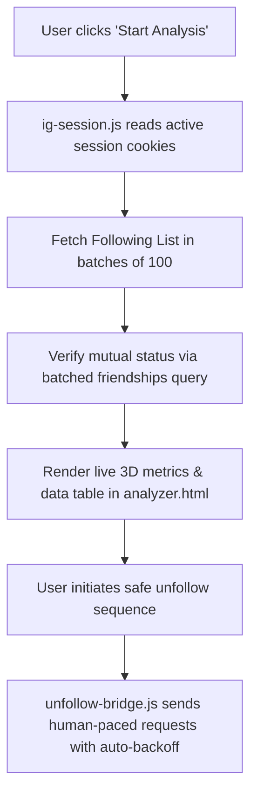

<p align="center">
  
</p>

<h1 align="center">Insta Unfollow (v3.0.0)</h1>

<p align="center">
  <b>The modern, safe, and powerful Instagram audience manager and non-followers tracker for Google Chrome.</b>
</p>

<p align="center">
  <a href="https://chromewebstore.google.com/detail/kdlobnohhjkneflmopckfidfekdkokcd">
    
  </a>
  
  
  
  
</p>

---

## 🌟 Overview

**Insta Unfollow** is a comprehensive, privacy-first Chrome Extension designed to help creators, brands, and everyday users understand their Instagram audience, detect fake/ghost followers, and safely clean up their following list without risking account action.

Unlike web-based scrapers that ask for your password and trigger Instagram checkpoints, **Insta Unfollow runs 100% locally in your own browser** using your active session with zero password transmission.

---

## ✨ Key Features

### ⚡ 1. Smart Non-Followers Detection
- **Instant Mutual Verification:** Instantly identifies accounts that do not follow you back.
- **Whitelist Protection:** Star your favorite creators, friends, and family to protect them from bulk unfollows.
- **Smart Filtering & Search:** Filter by non-followers, mutual followers, or verified badges with live search and CSV export.

### 🤖 2. Deep Bot & Ghost Follower Scanner
- **Multi-Factor Account Scoring:** Evaluates followers across behavioral signals:
  - Default / empty profile photos
  - High following-to-follower ratios (e.g. following 5,000 with 10 followers)
  - Suspicious or auto-generated username patterns
  - Zero posts or inactive feed
- **Verdict Categorization:** Quickly distinguishes between *Likely Bots*, *Suspicious*, and *Safe Accounts*.

### 🛡️ 3. Safe, Human-Paced Unfollowing
- **Safety Delay Controller:** Set human-like intervals between unfollow actions (120s recommended) to keep your account safe from algorithmic action blocks.
- **Smart Queueing:** Live visual queue with pause, resume, and emergency stop controls.
- **Auto-Backoff Protection:** Intelligently pauses and backs off if Instagram requests a cool-down.

### 🎁 4. Growth & Review Rewards System
- Integrated smart review incentive: Leave a 5-star review on the Chrome Web Store to unlock **+100 free bonus unfollows** instantly.
- Built-in anti-annoyance protection (cooldown timers, snooze, and lifetime limits).

### 🔒 5. 100% Privacy & Security First
- **Zero Credential Storage:** Never prompts for your Instagram password.
- **Zero External Scraping Servers:** All analysis runs in-memory directly on your client browser.
- **Strict Content Security Policy (CSP):** Manifest V3 compliant with zero unsafe inline scripts.

---

## 🚀 Getting Started

### Install from Chrome Web Store
The easiest way is to install the official verified release from the Chrome Web Store:
👉 **[Download on Chrome Web Store](https://chromewebstore.google.com/detail/kdlobnohhjkneflmopckfidfekdkokcd)**

*(Compatible with Google Chrome, Microsoft Edge, Brave, Opera, and Vivaldi)*

---

### Local Development / Load Unpacked

1. **Clone the repository:**
   ```bash
   git clone https://github.com/stymrj/insta-unfollow.git
   cd insta-unfollow
   ```

2. **Open Chrome Extensions settings:**
   - Navigate to `chrome://extensions/` in your browser.
   - Toggle **Developer mode** on (top-right corner).

3. **Load the extension:**
   - Click **Load unpacked** (top-left corner).
   - Select the cloned directory.

4. **Launch:**
   - Log into [Instagram](https://www.instagram.com) in your browser.
   - Click the **Insta Unfollow** extension icon from your Chrome toolbar and hit **Start Analysis**!

---

## 🏗️ Architecture & Project Structure

```
insta-unfollow/
├── manifest.json         # Manifest V3 extension configuration
├── popup.html / .js      # Toolbar popup interface
├── analyzer.html / .js   # Main dashboard: table, metrics, and unfollow command center
├── bot-scan.html / .js   # Bot and ghost follower scanner module
├── bot-detector.js       # Algorithmic scoring engine for bot detection
├── ig-session.js         # Cookie-based session bootstrap & profile resolution
├── unfollow-bridge.js    # Batched friendship status verification & actions
├── review-prompt.js      # Smart review & +100 bonus reward system
├── premium-config.js     # Tier pricing, checkout flows & verification
├── content.css           # Glassmorphism design system & component styles
├── premium-modal.css     # Frosted glass subscription & checkout modal styles
├── assets/               # Fonts (Inter), icons, and alert utilities
└── _locales/             # Multi-language localization (50+ languages supported)
```

---

## ⚙️ How It Works Under The Hood



---

## 🛡️ Permissions & Security Disclosure

| Permission | Justification |
| :--- | :--- |
| `cookies` | Reads `ds_user_id` and `csrftoken` from `instagram.com` to confirm your session without asking for passwords. |
| `declarativeNetRequestWithHostAccess` | Sets proper same-origin headers (`Origin`, `Referer`) on API requests to satisfy Instagram CSRF security. |
| `storage` & `unlimitedStorage` | Saves whitelist lists, scan cache, and local preferences directly on your device. |
| `identity` | Optional Google sign-in for cross-device Pro subscription verification. |

---

## 🤝 Contributing

Contributions, issues, and feature requests are welcome!

1. Fork the Project
2. Create your Feature Branch (`git checkout -b feature/AmazingFeature`)
3. Commit your Changes (`git commit -m 'feat: Add AmazingFeature'`)
4. Push to the Branch (`git push origin feature/AmazingFeature`)
5. Open a Pull Request

---

## 📄 License & Disclaimer

- **License:** Distributed under the MIT License.
- **Disclaimer:** This project is an independent tool and is not affiliated with, authorized, maintained, sponsored or endorsed by Instagram, Meta, or any of its affiliates. Use responsibly and adhere to Instagram's Terms of Use.

<p align="center">Made with ❤️ for Instagram Creators & Community</p>
